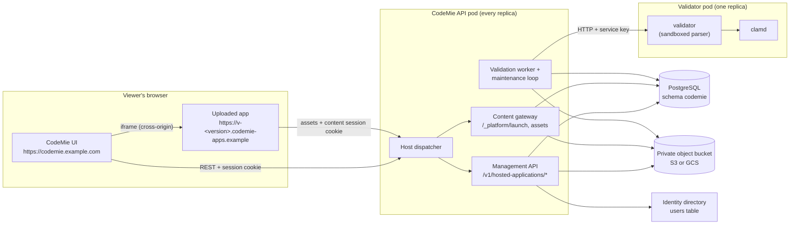
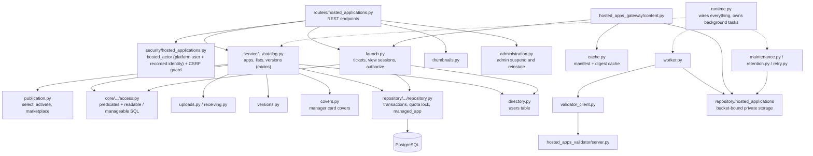
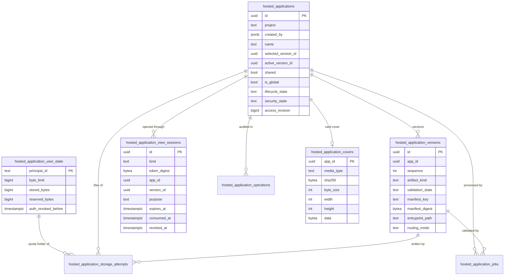
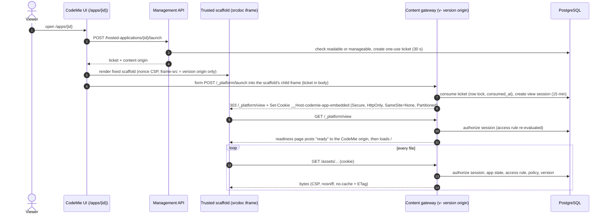
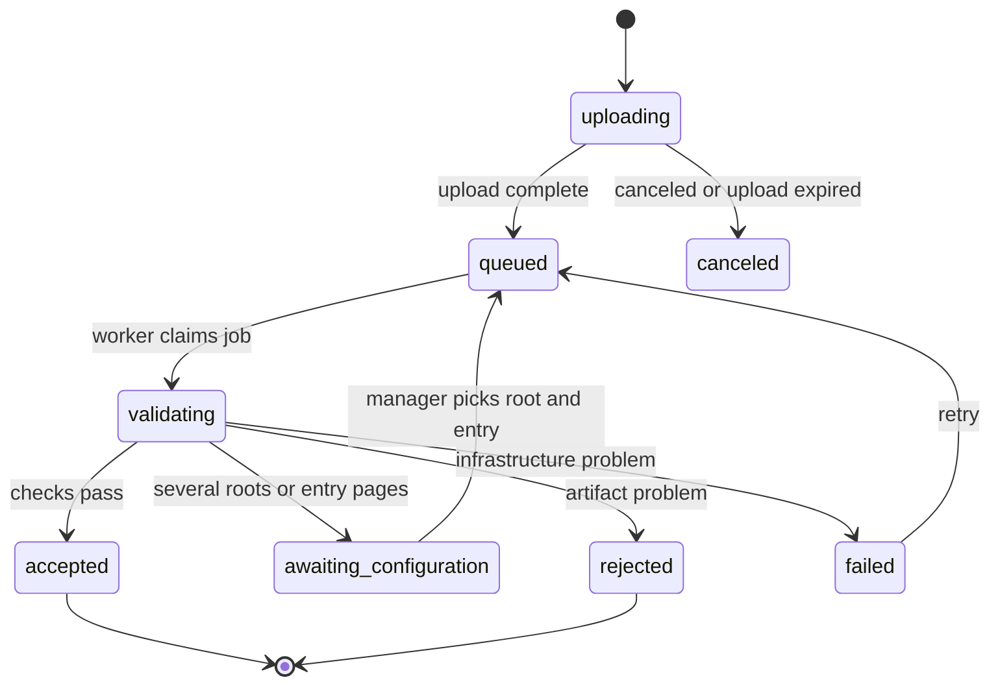
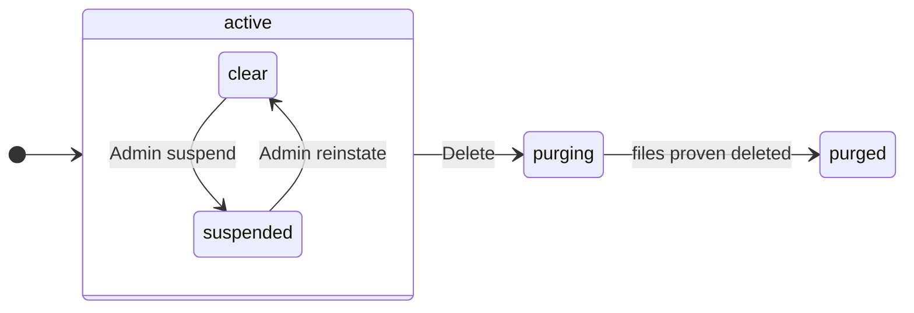
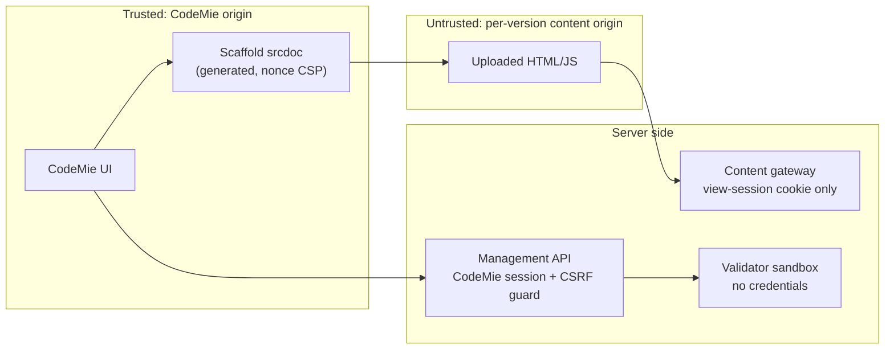
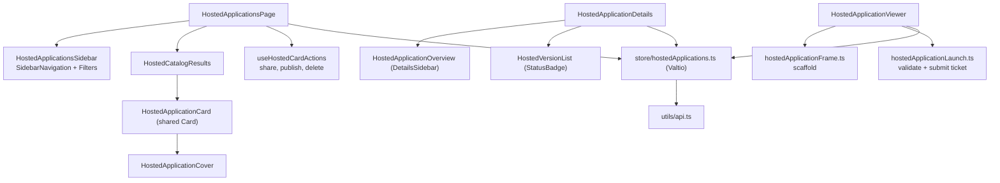
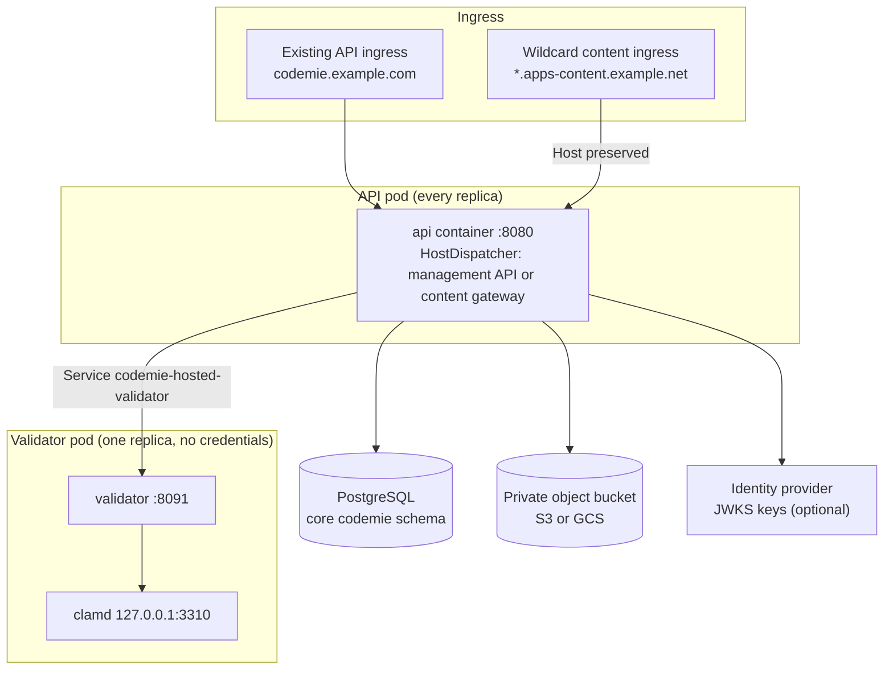

# Hosted Applications architecture

Hosted Applications lets CodeMie users upload a single HTML file or a ZIP of a prebuilt static
web app (React, Angular, Vue, plain HTML) into one of their projects, keep it for themselves and the
project's managers, share it with the project's members, publish it to the marketplace for every eligible
internal user, and open it inside the CodeMie UI at `/apps/{id}`. Access follows the platform access model
(project, creator, `Ability`), not a hosted-only audience or grant list.
The backend stores and serves files. Uploaded code runs only in the viewer's browser, on a
separate origin, and never with CodeMie credentials. There is no server-side rendering, no build
step and no container per application.

Feature ticket: EPMCDME-15659. Feature flag: the customer-config component `features:hostedApplications`
(off by default; `FEATURE_HOSTED_APPLICATIONS` overrides it). One switch turns the feature on for the UI
and the API together.
Operations runbook: [`hosted-applications/README.md`](../../hosted-applications/README.md).

## Decisions

| # | Decision | Rejected alternative and why | Cost we accept |
|---|---|---|---|
| D1 | Static artifacts only; apps execute in the viewer's browser. | A container or function per app: a runtime to patch, scale and isolate for every upload. | Apps cannot run server code or call external APIs (`connect-src 'self'`). Apps that need a backend do not fit. |
| D2 | The feature lives in the existing backend process and stores everything in the existing PostgreSQL database, in the core `codemie` schema, through the same Alembic chain. | A separate service with its own database: a second deployment, a second authentication path and a copy of the user directory. | Content traffic shares CPU with the management API. It gets its own capped connection pool and concurrency limits so it cannot starve core features. |
| D3 | Uploaded content is served from a separate registrable domain, one origin per version: `v-<version-id-hex>.<content-domain>`. | Serving under the CodeMie origin: uploaded JavaScript would run with the user's CodeMie cookies and storage. One shared content origin: every app could read every other app's storage and cookies. | Wildcard DNS and a wildcard TLS certificate on a second domain. Embedded viewing needs partitioned third-party cookies; browsers that block them use the "Open in new tab" path. |
| D4 | Server-side viewing sessions, re-authorized against the database on every content request. | Signed URLs or tokens in links: they leak through history, screenshots and copied links, and cannot be revoked. | Every content request performs an authorization query, which reads the access rule from `users` and `user_projects` in the same statement. Mitigated by one combined query (at most two per content request) and `no-cache` revalidation (304) instead of `no-store`. |
| D5 | Untrusted archives are parsed by a separate validator service inside a kernel sandbox (Landlock, seccomp, rlimits) and scanned by ClamAV, in two private pods (validator, clamd) outside the API pods; a NetworkPolicy admits only the validator to clamd. | Parsing ZIP and HTML inside the API process, next to database credentials. Validator and clamd as sidecars of every API pod: ClamAV's minutes-long signature load would decide whether the API pod is ready, and a scanner compromise would share the API pod's network and service account. | Two more Deployments, one replica each (a validation result lives in the pod that produced it). Validation pauses while either pod restarts; queued uploads wait. Scan traffic crosses the pod network, guarded by the clamd NetworkPolicy. The clamd liveness probe also restarts the container when its signature updater (freshclam) is not running, not only when clamd itself stops responding. API and validator must agree on policy version, policy-definition digest and protocol, so both images are built from the same commit. |
| D6 | Versions are immutable. A new upload creates a new version; making it live is an explicit action. | Overwriting files in place: viewers would see half-written bundles and there would be no rollback. | Storage holds several versions per app (the 10 newest accepted versions are retained by default). |

## System context



The management API and the content gateway run in the same process. The host dispatcher picks
one of them from the `Host` header before any management middleware runs:

- a host inside the content namespace (the content domain or any subdomain of it) goes to the
  closed content application, and never reaches management routes, docs or metrics;
- any other host, including Kubernetes probes that send the pod IP, goes to the management API
  exactly as it does without the feature.

## Backend components



| Package | Responsibility |
|---|---|
| `core/hosted_applications` | Pure logic shared with the validator: settings and origin policy, archive validation, manifest format, binary image checks, policy registry, path decoding, identity context, and the access module (`access.py`: the access predicates and the SQL `readable` / `manageable` conditions; it never imports the model). |
| `rest_api/routers/hosted_applications.py` | HTTP surface. Every route depends on `hosted_actor` (the platform `authenticate` dependency, a verified token context and a refusal of external users; it yields a `HostedActor` with the platform user and the recorded hosted identity) and, for mutations, on the CSRF and content-type guard. Sign-out revocation uses `hosted_identity` alone. |
| `service/hosted_applications` | Catalog and lists, publication and activation, uploads, versions, launch and authorization, admin suspend and reinstate, directory adapters, background workers and the `HostedApplicationsRuntime` that the FastAPI lifespan starts and stops. |
| `repository/hosted_applications` | Management transaction (keyed by the platform user; quota-holder row lock, `managed_app` lookup, idempotency, policy share lock) and the private file storage. |
| `hosted_apps_gateway` | Host dispatcher, the closed content application and the management body-size boundary. |
| `hosted_apps_validator` | The validator service: sandboxed parser subprocess and ClamAV client. It has no database or platform credentials. |

## Data model

Eight tables in the core `codemie` schema, created by Alembic revision `e3b7c1a95d42`. Users are not
duplicated: `created_by` (the platform `CreatedByUser` object, as on assistants and datasources) and
`principal_id` hold the existing CodeMie user id. Access comes from the application's `project`, which names an
existing CodeMie project, and from `users` and `user_projects`. No hosted table or identity field carries an
organization or token issuer, so changing `JWT_ISSUER` keeps every user and what they created.



| Table | What it holds |
|---|---|
| `hosted_application_user_state` | One row per user who used the feature: quota limit and usage (`stored_bytes`, `reserved_bytes`) and the durable logout cutoff. The row of an application's creator is the quota holder for everything stored under it, whoever uploads. A mutation locks that row first (see Lock order), which serializes the mutations of one creator's applications. |
| `hosted_applications` | Metadata, `project` (indexed), `created_by` (NOT NULL; an expression index on `created_by->>'id'` with `updated_at DESC, id DESC` serves "mine"), the version selected for the managers' preview, the live version, `shared` (project members may open it), `is_global` (listed in the marketplace for every eligible internal user), lifecycle (`active`, `purging`, `purged`) and `security_state` (`clear` or `suspended`). `access_revision` changes only when the application is deleted or purged and invalidates open viewing sessions; every other change in access (sharing, unpublishing, suspension, membership) is read from the database on the next content request. |
| `hosted_application_versions` | One row per uploaded version: upload state, validation state, accepted manifest (key and SHA-256), entry page and routing mode. Accepted versions never change. |
| `hosted_application_storage_attempts` | A ledger entry for every storage prefix written, with the byte reservations, `quota_principal_id` (the quota holder, always the application's creator), writer fencing tokens and deletion proof. Quota is released only after the files are proven gone. |
| `hosted_application_jobs` | Durable queue for validation, cleanup, retention and purge, with leases and deadlines. |
| `hosted_application_operations` | Idempotency keys (replayed for 24 hours) and the audit trail of successful mutations and every launch (Open and manager Preview). Every record is deleted after 180 days. |
| `hosted_application_view_sessions` | Revocable content-access state: the binding to the existing CodeMie login (`auth_context`), one-use launch tickets (up to 30 seconds) and scoped viewing sessions (up to 15 minutes). Stores HMAC token/binding digests, identity/scope and expiry/revocation metadata; no raw CodeMie JWT, refresh token, password or content cookie. See the design questions below. |
| `hosted_application_covers` | An optional card cover set by a manager, at most one per application: a PNG, JPEG or WebP of at most 1 MiB and 2048 px per side, with its SHA-256 and dimensions. Only the thumbnail endpoint reads the image bytes; catalog queries read keys only. Its bytes count as the quota holder's stored bytes under the storage quota; removing it or deleting the application refunds them. |

Two platform tables, shared with other resource types, hold who an application is shared with:

| Table | What it holds for hosted applications |
|---|---|
| `permissions` | Named and link grants: `resource_type='HOSTED_APPLICATION'`, `principal_type=USER`, `principal_id=<users.id>`, `permission_level=READ`, `grant_source` (`name` or `link`) and, for a link grant, `source_link_id`. `created_by` is the owner who granted (for a link grant, the link's owner, never the opener). The same table holds assistant grants (`resource_type='ASSISTANT'`). |
| `share_links` | Revocable share links of any link-sharing resource type (only hosted applications today): `resource_type`, `resource_id`, the token (plaintext, for the owner's re-read) and its SHA-256 (the only lookup key), creator, creation and revocation. At most one live link per resource (`uq_share_links_live` on `(resource_type, resource_id) WHERE revoked_at IS NULL`); a revoked row stays as a tombstone. No foreign key to the resource, as on `permissions`; `permissions.source_link_id` references `share_links.id` `ON DELETE RESTRICT`, so a link row never takes its grants with it. |

The security policy registry is a code constant, `PERMITTED_POLICIES` in
`codemie.core.hosted_applications.policy`, not database state. It lists the validation policy versions under
which accepted versions may be served, each with its exact definition digest; a deploy that removes an entry
withdraws the versions validated under it.

Files live in a dedicated object-storage bucket (`HOSTED_APPS_STORAGE_BUCKET`), outside the
generic user-file area. `FILES_STORAGE_TYPE` selects the backend: `aws` uses S3, `gcp` uses GCS.
`filesystem` uses the `HOSTED_APPS_STORAGE_DIR` directory and is for local development and tests
only. Outside `ENV=local` or `ENV=test` it is refused at startup and the feature stays off with "Hosted applications need object storage". `azure` keeps hosted applications
unavailable (`Hosted applications do not support Azure storage yet`).

Each write goes to a fresh prefix (`a-<app hex>/<app hex>/<version>/<attempt>/...`) and is never rewritten.
The prefix is keyed by the application id: nothing reads an owner back from a key, so a change of creator or
project moves no files. Only the random attempt id makes a prefix unique, and every read, cleanup and sweep uses
the prefix stored on the attempt row; the sweep recognizes only this shape.
The adapter never shares the files bucket (`AWS_S3_BUCKET_NAME` or the per-owner GCS buckets) and
never creates a bucket. It reuses only the client setup (credentials and region) of the files
storage. A `.hosted/storage-id` object in the bucket binds ledger rows to that bucket: namespaces
become `:bucket:<id>`, so a replica that sees a different bucket cannot "prove" a deletion. The
keys `.hosted/`, `.fences/` and `.staging/` are reserved.

- **S3.** Every object is a multipart upload. The adapter presigns the Create and Complete
  requests with an expiry bound to the database writer lease, minus the monotonic time since the
  last heartbeat. Complete carries `If-None-Match: *`. Cleanup waits for the lease end plus
  `HOSTED_APPS_STORAGE_S3_GRACE_SECONDS` (default 30). Startup refuses S3 when the clock skew
  between S3, the database and the pod exceeds that grace (log code `STORAGE_CLOCK_SKEW`).
- **GCS.** A fence object, a staging resumable upload and a compose call with generation
  preconditions commit each object. There are no signed URLs, no `signBlob` and no Token Creator
  role.
- **Cleanup.** Cleanup runs in bounded, resumable steps. A deletion proof exists only after a
  verifying pass.
- **Sweep.** The runtime task `hosted-storage-sweep` runs every `HOSTED_APPS_STORAGE_SWEEP_SECONDS`
  (default 3600), within `HOSTED_APPS_STORAGE_SWEEP_BUDGET_SECONDS` (default 20), on one replica only: each
  iteration runs under the platform's advisory leader lock (`async_leader_lock`,
  `HOSTED_STORAGE_SWEEP_LOCK_ID`), and the other replicas skip that period. The leader holds one connection of
  the core sync pool for the length of the walk (at most the budget). The resume token is per process, so a new
  leader starts its walk from the beginning of the bucket. It deletes
  objects older than 1 day under the prefix of a `deleted` attempt or with no attempt row. It
  skips the reserved keys and logs an ERROR `hosted_storage_orphans_deleted` with the key count.
- **Executor.** The object backends use their own executor, sized to the gateway concurrency (64)
  plus 16. The filesystem adapter keeps `STORAGE_EXECUTOR`.

The bucket is private and backend-only. Versioning is off, Object Lock is off and public access is
blocked. Lifecycle rules: on S3, abort incomplete multipart uploads after 1 day; on GCS, delete
`.staging/` and `.fences/` objects after 1 day. The API identity needs the bucket object role (S3:
`s3:GetObject`, `s3:PutObject`, `s3:DeleteObject`, `s3:ListBucket`, `s3:ListBucketMultipartUploads`,
`s3:AbortMultipartUpload`, `s3:ListMultipartUploadParts`; GCS: `roles/storage.objectUser`). Use one
bucket per deployment: see the Trade-offs below. The content gateway authorizes each request and
streams bytes from the bucket.

## Flows

### Create, upload and validate

```mermaid
sequenceDiagram
    autonumber
    actor Manager
    participant UI as CodeMie UI
    participant API as Management API
    participant DB as PostgreSQL
    participant FS as Private bucket
    participant W as Validation worker
    participant V as Validator pod
    participant AV as clamd

    Manager->>UI: Create application (name, description, project, file)
    UI->>API: POST /hosted-applications (Idempotency-Key)
    API->>DB: insert app (project, created_by; not shared, not global)
    UI->>API: POST /{id}/versions (size, kind, routing)
    API->>API: validate identity, manage access, filename, kind, declared size
    API->>DB: reserve quota on the creator's row, create version + upload attempt
    UI->>API: PUT /{id}/versions/{vid}/artifact (streamed bytes)
    API->>FS: write source into the attempt prefix (size and SHA-256 checked)
    UI->>API: POST /{id}/versions/{vid}/complete
    API->>DB: queue validate job
    W->>DB: claim job (SKIP LOCKED, lease 30 s, heartbeat)
    W->>V: stream source, ask for inspection
    V->>V: enforce actual input size and verify source SHA-256
    V->>AV: scan original artifact
    V->>V: parse in sandboxed subprocess (paths, sizes, types, ratios)
    V->>AV: scan every extracted file
    V-->>W: candidate manifest + findings + scanner version
    W->>V: fetch each accepted file
    W->>FS: write files and manifest into a new fenced prefix
    W->>DB: version accepted, quota moved from reserved to stored
    UI->>API: poll version state
    API-->>UI: Ready
```

When a ZIP contains several possible site roots or entry pages, the version stops in
`awaiting_configuration` and a manager picks them in the security-checks dialog. A worker that
loses its lease is fenced out: its writes are rejected and the prefix is cleaned up.

### Open an application



The ticket travels only in a POST body and is never placed in a URL, storage or the uploaded
document. The scaffold is generated by CodeMie, contains no uploaded markup, and only forwards a
constant "ready"/"unavailable" hint after checking the message's source window and origin. The
hint changes the loading indicator; it never grants access.

"Open in new tab" reserves a named tab during the click, then posts a fresh ticket into it. The
content response sends `Cross-Origin-Opener-Policy: same-origin`, which severs the link back to
CodeMie. Ticket redemption redirects to `w-<version-id-hex>.<content-domain>`, a trusted,
full-window wrapper that frames only the matching `v-` version origin. Its single fixed script is
authorized by its CSP SHA-256 hash. The uploaded
child cannot alter this different-origin wrapper or its explicit camera, microphone, geolocation,
payment, USB and fullscreen denials. Direct top-level navigations to an authorized `v-` document
redirect through the wrapper too. This addresses WebKit's missing top-level Permissions-Policy
header enforcement while keeping a separate `SameSite=Lax` cookie on the `v-` host; `v-` and `w-`
share a site on the supported HTTPS deployment domain. That deployment remains to be qualified
in Safari; local HTTP `.localhost` testing currently refuses the child cookie in Safari/WebKit.
The wrapper contains no application metadata, uploaded markup, launch ticket or viewing credential.
It is served by the existing gateway under the same wildcard DNS/TLS configuration.

Interactive HTML navigation responses append a fixed route-reporting hook without changing stored
version bytes. The wrapper accepts route hints only from its exact child window and origin, and
copies only bounded paths within its own origin. This preserves history and hash routes on refresh;
the hints never authorize content or carry credentials. The navigation representation has its own
ETag, length and streamed range handling. Ordinary asset fetches retain the original bytes. The parent frame's permissions remain the security boundary even if an app tampers
with its own route hook.

### Authorization on every content request

A content request is served only when all of these hold at that moment:

1. The session cookie matches a stored, unexpired, unrevoked view session for this version host.
2. Its login binding is still valid and was issued after the user's last logout cutoff.
3. The application is active and its `access_revision` matches the session.
4. The access rule holds for the session's user, evaluated in the same statement that loads the session.
   A manager preview needs `manageable`; a published view needs `readable`. Managers read the working
   version and, when the application is suspended, are the only ones who can still open it. A viewer needs
   the live version.
5. The viewer is an eligible user (active, not deleted, not external) in `users`; membership comes from
   `user_projects` in that same statement, so no membership cache is involved.
6. The version's validation policy is still permitted by the policy registry.
7. The stored files match the accepted manifest digest.

At most two queries run per content request. No token claims are consulted for access; the credential's
principal id is the only identity input. HEAD, range, conditional (304) and error responses all pass through
the same checks and carry the same security headers.

### Access model

An application belongs to one `project` and records its creator in `created_by`. Who can do what is decided by
`core/hosted_applications/access.py`, which the model, the lists, the management transaction and the gateway
all use. The module never imports the model: the model implements the platform `Owned` interface by delegating
to it, and `Ability.PERMISSIONS["HostedApplications"]` maps roles to actions.

| Role | Who | Can |
|---|---|---|
| Creator (owner) | `created_by.id` equals the user | Everything a manager can, plus share with named people and by link (`can_share`). |
| Manager | The creator, an admin of the application's project, or a platform administrator (maintainers included) | Open the working version, upload and select versions, activate, edit metadata and covers, delete, publish to or unpublish from the marketplace. |
| Viewer | `shared` and a member of the project, `is_global`, or a live grant (by name or by link); never while suspended | Launch the live version. |
| Nobody | External users; users who are inactive or deleted | Not found, including every list. |

Two SQL conditions encode this, `manageable` and `readable` (`readable` includes `manageable`), joined to
`users` and `user_projects`; `manageable` takes the action (WRITE to change the app, DELETE on the delete path) so a
later per-person edit grant can never imply delete. The same rule has Python predicates for loaded objects
(`is_owned_by`, `is_managed_by`, `is_shared_with`, and `is_granted` behind the action-aware `Role.GRANTED` of
`Ability`, registered under READ only). Both read the roles from the same rows: the predicates, the response
abilities, the list scopes and the administrator check of suspend and reinstate take the caller's
platform-admin, project-admin and membership flags from `users` and `user_projects` (`platform_user`), never
from the request's IdP roles or `ENV=local`. An application the caller may not read is answered `404`, as if it
did not exist.

| Setting | Changed by | Effect |
|---|---|---|
| `shared` | `PATCH` by any manager | Project members may open the live version. Needs a project the caller may use. |
| `is_global` | `POST /marketplace/publish` and `POST /marketplace/unpublish` by a manager | Listed in the marketplace; every eligible internal user may open it. Publishing needs no active version; opening does (`NO_ACTIVE_VERSION`, 409). |
| `security_state` | Platform administrators only | `suspended` removes the viewer term. Managers keep access. |

`POST /{id}/activate` makes an accepted version live (`activate(tx, app, version)` in `publication.py`, which
also moves the working version). A suspended application refuses `activate`, `publish`, turning `shared` on and
moving to another project with `APP_SUSPENDED` (409); unpublishing, turning `shared` off and deleting stay
allowed. The list lives once, `SUSPEND_GATED_ACTIONS` in the access module, and every application response carries
it as `suspension_refuses` (the refused actions while suspended, else empty).

Lists take a `scope`: `mine` (created by the caller), `project` (applications of the caller's projects; for a
platform administrator or maintainer, every project's applications, private ones included, as for skills),
`marketplace` (`is_global`) and `shared` (applications the caller holds a live grant on and did not create). Each
is filtered by `readable`, so a scope can never return more than the access rule allows. Opening by id uses
`manageable` for managers and `readable` for everyone else. There is no moderation list: platform administrators
suspend, reinstate and revoke a share link from the application's own actions, and find any application in the
Project tab or open it by its URL.

Unpublishing, unsharing, deleting, suspension, losing project membership and policy revocation take effect on the
next request of every open viewing session, because the per-request check reads all of them from the database.
Signing out of CodeMie writes a durable cutoff that ends every viewing session of that user, on every device.

Admin suspend and reinstate (`POST /admin/hosted-applications/{id}/security/{suspend|reinstate}`, platform
administrator, a reason required; Suspend and Reinstate dialogs in the UI) sets only `security_state`: sharing and the marketplace flag are left as
they were, so a reinstated application is exactly as it was. Reinstating is refused for the creator
(`INDEPENDENT_REVIEW_REQUIRED`). A reinstate may name a version (`version_id`, default the current live one) to
make active, and may delete the previous live version (`delete_previous`, through `retire_version`). The
idempotency digest covers `{reason, if_match, version_id, delete_previous}`, and the audit record names the
administrator and the version made active.

The access rule is not a tenant boundary beyond the project: `is_global` means every eligible internal user in
the `users` table (active, not deleted, not external; service accounts included), so tenants that share one CodeMie deployment share the marketplace. The principal is the CodeMie
user id; hosted data does not depend on the token issuer.

Known gap: a user who is disabled or deleted only in the sign-in provider stays active in `users`
until a CodeMie admin deactivates them. That user cannot sign in again, so cannot start a new viewing
session. Existing access ends with the current viewing session or at sign-out.

### Named grants and share links

Sharing with named people and by link uses the platform's shared modules, not hosted code of its own; assistants
share by name through the same modules.

- Named grants: `service/permission/named_grant_service.py` with the `NAMED_GRANT_TYPES` descriptor registry
  (`named_grant_types.py`; hosted descriptor `service/hosted_applications/grant_descriptor.py`). Owner only; a
  grantee must be an active, not deleted, internal user. `live_grants` (in `rest_api/models/permission.py`) is the
  one statement of a live grant: it counts only for an eligible internal user while `ENABLE_USER_MANAGEMENT` is
  on. The SQL viewer term, `scope=shared` and the Python grant term are built on it. Hosted code reads the
  caller's grants once per transaction on its own pool (`named_grant_service.apreload`) and passes them as
  `Ability(user, grants=...)`; any other `Ability` check loads the user's grants of a class itself, once per
  `Ability` object (`named_grant_service.load_class_grants`).
- Share links: `service/permission/share_link_service.py` with the `SHARE_LINK_TYPES` registry
  (`share_link_types.py`). A link type is also a named-grant type: the owner rule, the suspend refusal
  (`before_grant`), the audit attributes and the recipient rule come from the grant descriptor, and the hosted link
  descriptor (`service/hosted_applications/share_link_descriptor.py`) adds only the link events, the readability
  check, `tx.lock_app`, the link answers and who may revoke. The owner gets or creates the
  live link (`POST /{id}/share-link`, refused while suspended) and reads it (`GET /{id}/share-link`).
  `DELETE /{id}/share-link` (the owner, or a platform admin or maintainer who reaches the app by id, so a leaked
  link is stopped without suspending the app) calls `arevoke`, the one revoke step: it tombstones the link and
  removes every grant the link made, each audited with the revoker as actor. Opening (`POST /share-links/open`, token in the body) by an eligible internal user
  who cannot read the app yet locks the app row, re-reads the link and writes one link grant
  (`ON CONFLICT DO NOTHING`, so a by-name grant wins); the grant row's creator is the link's owner, the opener is
  its principal and the audit actor. Unknown, revoked, deleted or suspended all answer the same 404
  `SHARE_LINK_NOT_AVAILABLE`.
- A by-name grant replaces a link grant for the same person, so it survives a link revoke. Removing a link
  recipient by name ends their access, but they can come back through the live link until it is revoked.
- Generic permissions API: `POST /v1/permissions` refuses hosted (and assistant) grants; `DELETE
  /v1/permissions/{id}` removes one, audited, for a platform admin or maintainer or the app's creator
  (`grant_remover`, read from `users`).

### Lock order

Every management mutation takes locks in one order, which is also the order the retention, purge and admin
paths use: the quota-holder row (the creator's `hosted_application_user_state` row, `FOR UPDATE`, which also syncs the
quota), then the application row (`FOR NO KEY UPDATE`), then access is checked again on the locked row
(`managed_app(app_id, user, lock=True)`). The quota holder is the creator, not the caller: a project admin or
platform administrator who edits someone else's application never locks their own row, and uploads are charged
to the creator's quota. A write by a user with no recorded hosted identity is refused with `401`. `retire_version`
(`retention.py`) takes no locks of its own, so the caller holds them; it refuses a version that is live,
selected or has a ready or running job (`VERSION_IN_USE`, 409), and both retention (as the system actor) and
reinstate (as the administrator) call it.

### Card covers

The card image is chosen in this order:

1. a cover image a manager uploaded for the application;
2. a validated raster bundled in the upload (`preview.png`, `thumbnail.*`, `cover.*`, … up to 1 MiB, 2048 px);
3. the application's initials.

Cards never render the application itself, and the gateway has no static-preview mode: a launch costs a
ticket redemption and live authorization of every file it loads on the hosted database pool, which a card grid
must not multiply. Only an explicit Open or a manager's Preview launches an application, and every launch is
audited.

A manager sets the cover with `PUT /v1/hosted-applications/{id}/cover` and
`DELETE /v1/hosted-applications/{id}/cover`. Both need `If-Match` (the application ETag) and an
`Idempotency-Key`, work only on active, non-suspended applications, change the application's revision
and are audited as `app.cover.update` / `app.cover.delete` without the image. The upload is the raw
image body with `Content-Type` exactly `image/png`, `image/jpeg` or `image/webp`; the file signature
must match that type and the structure and header dimensions are checked without decoding the image
(`415 UNSUPPORTED_MEDIA_TYPE`, `422 INVALID_COVER`, `413 COVER_TOO_LARGE` above 1 MiB, `409 QUOTA_EXCEEDED` past the quota holder's storage quota). Both return
the application with `has_cover`; removing a missing cover is a no-op. `GET .../thumbnail` serves the
uploaded cover before any bundled raster, to managers while the application is active and to viewers
under the same visibility rule as bundled rasters.

## Lifecycle





Delete (`DELETE /v1/hosted-applications/{app_id}`, answered `202`) is irreversible: it moves an
active application, shared or not, straight to `purging`. In the same transaction it clears the version
pointers, bumps `access_revision`, revokes the live share link (with the grants it made), removes every other
grant (each audited), cancels jobs and
fences upload attempts. The application is at once absent from every list and every lookup by id
(`404`), and open viewing sessions are denied on their next content request. The background purge then
removes files and versions, refunds the bytes to the creator's quota and reaches `purged`;
`GET /{app_id}/deletion-status` reports progress. A purged row keeps only its id, its project,
the creator's id (the creator's username and name are cleared, enforced by a CHECK constraint), its sharing flags
and timestamps while audit records refer to it; it is deleted 180 days after the purge, with them and with its
`share_links` rows (deleted explicitly before the application row, since `share_links` has no foreign key to it).

## Security boundaries



| Control | Where |
|---|---|
| Separate registrable content domain, checked at startup against the public suffix list, `FRONTEND_URL`, the identity provider and the other first-party URLs | `core/hosted_applications/settings.py` |
| One origin per version; host-only `__Host-` cookies; the session is bound to the version host | `content.py`, `launch.py` |
| CSP on every content response: `default-src 'none'`, `script-src 'self' 'unsafe-inline'` (no `unsafe-eval`), `connect-src 'self'`, `frame-ancestors` = CodeMie origins, `worker-src 'none'`, `form-action 'none'`, `sandbox allow-scripts allow-same-origin`; plus `nosniff`, `no-referrer`, COOP/CORP same-origin, `X-DNS-Prefetch-Control: off`, and a `Permissions-Policy` requesting denial of camera, microphone, geolocation, payment, USB and fullscreen; enforcement depends on browser support | `content.py` |
| Iframe sandbox without top navigation, popups or forms; explicit iframe permission denials, including fullscreen; postMessage source and origin checks | `utils/hostedApplicationFrame.ts`, `HostedStaticCover.tsx`, `HostedApplicationViewer.tsx` |
| CSRF guard on every mutation (exact Origin, Sec-Fetch headers, exact content type: JSON, or the raw artifact or cover image type) and `If-Match` + `Idempotency-Key` on writes | `rest_api/security/hosted_applications.py`, routers |
| Every query filtered by the access module's `readable` / `manageable` conditions; an unreadable application is `404`; external users are refused at the `hosted_actor` dependency | `access.py`, `catalog.py`, `repository.py` |
| Upload limits enforced on decompressed bytes: 20 MiB HTML, 100 MiB ZIP, 500 MiB expanded, 50 MiB per file, 5000 files, ratio 100; no symlinks, devices, absolute or backslash paths, encrypted entries, nested archives or case collisions | `core/hosted_applications/validation.py` |
| Malware and secret scanning are mandatory and fail closed when the scanner is unhealthy or its signatures are older than 48 hours | `hosted_apps_validator/scanner.py` |
| Per-process content capacity: 64 requests in flight, at most 16 of them for one viewer, a 5-second queue and a 120-second request limit. No per-request counters in Redis or the database: floods from outside are the edge's job, as for every CodeMie route | `admission.py`, `content.py` |
| Per-person limits that bound stored rows and validator work: 500 applications per creator, two validations at a time, plus the storage quota of the creator | `catalog.py`, `uploads.py` |

**Browser qualification:** The own-tab implementation uses a trusted, cross-origin `w-` wrapper with explicit
iframe permission denials and a hash-authorized route script. Genuine fullscreen gestures and
isolation probes pass in current Chrome and Firefox. Local HTTP Safari/WebKit child authentication
fails; supported HTTPS qualification remains open. WebKit's
[current PermissionsPolicy implementation](https://raw.githubusercontent.com/WebKit/WebKit/main/Source/WebCore/html/PermissionsPolicy.cpp)
does not implement the declared response policy for ownerless documents. Native Safari still
requires its own qualification. Uploaded JavaScript must never enforce this boundary itself.

The isolation boundary is the scaffold's child frame, not the scaffold. The scaffold is an
`about:srcdoc` document on the CodeMie origin: the UI reads it to confirm its child frame before
posting a ticket, and it relays the app's ready signal to the exact UI origin. Its
`sandbox="allow-scripts allow-same-origin"` therefore does not isolate it, and Chrome logs "An iframe
which has both allow-scripts and allow-same-origin for its sandbox attribute can escape its
sandboxing" for it. That is expected: the scaffold runs only code CodeMie generated, under its own
nonce CSP. Uploaded code runs one level down, on its own version origin, under its own sandbox.

Residual risks:

- An app can still leak data it was given through channels CSP does not cover: WebRTC (the CSP
  `webrtc` directive is not implemented by Chromium or Firefox, so the gateway does not send it) and
  DNS lookups. It can also draw a convincing fake dialog inside the CodeMie page. The viewer header always names the creator and states that
  the content is provided by them.
- Rotating `HOSTED_APPS_CREDENTIAL_SECRET` invalidates sessions and idempotency replays; see the
  runbook for the procedure.

## Frontend

The route table, tabs, access predicates and sharing components are kept in the design spec, section 10.1
(`docs/superpowers/specs/2026-11-06-EPMCDME-15659-hosted-apps-design.md`). In short:

| Route | Component | Purpose |
|---|---|---|
| `/apps`, `/apps/project`, `/apps/marketplace`, `/apps/shared`, `/apps/platform` | `HostedApplicationsPage` | My apps, Project, Marketplace, Shared with me (API scopes `mine`, `project`, `marketplace`, `shared`) and Platform apps |
| `/apps/new` | `HostedApplicationsPage` + `HostedMetadataDialog` | Create dialog (deep-linkable) |
| `/apps/share/:token` | `HostedSharePage` | Share-link redemption |
| `/apps/:id` | `HostedApplicationViewer` | Embedded viewer inside CodeMie navigation |
| `/apps/:id/preview/:versionId` | `HostedApplicationViewer` | Manager preview of one version |
| `/apps/:id/manage` | `HostedApplicationDetails` | Details, versions, sharing and marketplace, lifecycle, admin actions |
| `/applications` | redirect | Old entry point, redirects to `/apps` |



The store owns server state that several screens share (capabilities, catalog page; abilities, `can_share`, `can_moderate`, `suspended` and `has_active_version` come with each application) and fences every response with an authentication epoch, so a response that arrives
after a sign-out or user switch is dropped. While `features:hostedApplications` is off, the store
never calls the hosted API: the Applications page shows only Platform apps, and the viewer and
details routes send people there.

## Background processing

`HostedApplicationsRuntime` starts two validation loops and one maintenance loop per API replica. All of them coordinate through the database (`SKIP LOCKED`,
leases, fencing tokens), so any number of replicas can run them. On object storage it also starts the storage
sweep, which runs on the leader replica only (see Storage).

| Loop | Does |
|---|---|
| Validation | Claims queued jobs, drives the validator, writes accepted files, finishes or fails versions. |
| Expiry | Fails jobs whose lease expired and cancels uploads past their deadline. |
| Cleanup | Deletes storage prefixes marked for deletion after proving no writer holds them, then releases quota. |
| Purge | Finishes deletion once every prefix of an app is gone. |
| Retention | Schedules removal of old accepted versions (keeps the newest 10), and rejected versions after 30 days. |
| Retry | Re-queues failed validations with backoff (up to 3 times). |
| GC | Removes expired tickets and sessions, scrubs idempotency replay bodies after 24 hours, deletes audit records older than 180 days and removes purged applications' rows after the same period. |

Each maintenance step runs in its own error boundary, so one failing step does not stop the
others.

## Configuration and deployment

The runbook, [`hosted-applications/README.md`](../../hosted-applications/README.md),
is the operational reference: every setting with its range, ingress rules, identity prerequisites,
storage qualification, secret rotation, rollout and monitoring. This section shows how the parts
fit together.



`hosted-applications/kubernetes.yaml` holds the objects next to the API release: the
validator Deployment (validator and clamd containers, one replica, no service-account token), its
ClusterIP Service and NetworkPolicy, and the wildcard content Ingress. The API
container gets its settings, including the bucket, through the chart's `extraEnv`. Build the validator and API images from the same commit. Both compute a digest
of the shared policy definition; validation rejects a policy version/digest mismatch. That digest is
not a hash of the whole implementation or image.

The feature adds six settings. Everything else comes from settings the platform already has, or is a
constant in the code (the runbook lists the constants):

| Concern | Source | What it decides |
|---|---|---|
| Switch | Customer config `features:hostedApplications` (`FEATURE_HOSTED_APPLICATIONS` overrides it) | Off by default, for the UI and the API together. When on, startup checks everything below; a configuration that cannot run safely keeps the feature off and logs which check failed. |
| Content origin and routing | `HOSTED_APPS_CONTENT_DOMAIN` | The separate content domain (D3). |
| UI origin | `FRONTEND_URL` (platform) | The only origin allowed to frame content and send mutations, the same origin the API trusts for CORS. |
| Identity | `IDP_PROVIDER`, `ENABLE_USER_MANAGEMENT` (must be `true`), optional `JWKS_*` (platform) | Startup refuses the feature without user management (`Hosted applications need user management (ENABLE_USER_MANAGEMENT=true)`). Every `IDP_PROVIDER` works, with JWKS validation on or off. `JWT_ISSUER` is not read by hosted code. The `users` and `user_projects` tables serve the access rule and publisher names. Service accounts can launch applications they can read. The hosted identity comes from the token the platform accepted: the validated local JWT (`local`), `x-auth-request-access-token` (`keycloak`), `Authorization: Bearer` (`oidc`, `entraid-oidc`), or the token `JwksValidatingIdp` verified (any provider with JWKS on). Hosted applications check the token's `exp` only when the platform does (local JWT, JWKS); for a token the platform accepts without checking `exp`, the sign-in follows the platform session instead, renewed for 24 hours by each accepted request. Without a `sid` in a checked token, a viewing session lasts one token lifetime. Without JWKS validation, the API must be reachable only through the ingress. The content domain must not share a registrable domain with the identity provider. |
| Secrets | `HOSTED_APPS_CREDENTIAL_SECRET`, `HOSTED_APPS_VALIDATOR_KEY` | HMAC key for sessions, tickets and idempotency, and the key shared with the validator. Both come from the secret manager. |
| Storage and quota | `FILES_STORAGE_TYPE`, `HOSTED_APPS_STORAGE_BUCKET`, `HOSTED_APPS_QUOTA_BYTES` | The backend, the dedicated bucket for version files, and the per-creator quota (2 GiB by default) that version files and card covers share. |
| Validation | `HOSTED_APPS_VALIDATOR_URL` | The private validator Service, for example `http://codemie-hosted-validator:8091` (loopback in local development). Plain HTTP inside the cluster, like the platform's other internal services: the NetworkPolicy admits only API pods and the service key authenticates the API; a service mesh adds mTLS where one exists. |

The hosted database pool (10 connections, 2 s wait) is separate from the core pool on the same
database, so a saturated feature answers `503 SERVICE_BUSY` instead of taking core connections.

Database changes ship as two Alembic revisions in the core chain and run in the normal migration step:
`e3b7c1a95d42` creates the eight feature tables with their constraints and indexes (and the `pg_trgm` extension for
the search index), with the `filesystem`, `aws` and `gcp` storage providers; `f8d24a6c0b17` changes the tables
other entities share: it adds `HOSTED_APPLICATION` to `codemie.resourcetype`, creates the common `share_links`
table, adds `grant_source` / `source_link_id` with their CHECK and the `share_links` foreign key to the platform
`permissions` table, and sets `grant_source='name'` on existing assistant grants. The design spec, section 4, lists them.

## Trade-offs of object storage

- No ReadWriteMany volume is needed. The cost is object-store latency for each Range window (8 MiB).
- Every S3 object is a multipart upload. This adds requests, but it gives a fenced commit.
- S3 relies on clock bounds (the grace period and the startup skew check). GCS uses fences instead.
- One replica walks the bucket per sweep period (the advisory leader lock); the others skip it.
- Use one bucket per deployment. Two deployments on one bucket read the same `.hosted/storage-id`,
  bind the same namespace, and each sweep deletes the objects of the other. A database restored to
  an older point turns newer attempts into orphans, and the sweep removes them after 1 day.
- The filesystem adapter is kept for development only. It is not supported in production.
- Azure is not supported yet. Hosted applications stay unavailable with `FILES_STORAGE_TYPE=azure`.

## Design questions and rationale

These answers describe the current code.

### Why a validator pod with two containers?

The validator checks static-bundle structure, paths, file types, expansion limits and manifests in
a sandboxed parser. The resident ClamAV daemon supplies malware scanning and updated signatures.
Neither check replaces the other. Both run in one private pod, once per deployment, not per API
replica and not per hosted application:

- **Not sidecars of the API pod.** A pod is ready only when all its containers are. ClamAV loads
  its signatures for minutes after every start, and a blocked signature download would keep the
  API pods out of service. A scanner compromise would also share the API pod's network and
  service-account token. In its own pod the validator has neither.
- **Two containers, not one.** clamd comes from the upstream ClamAV image, which ships its own
  updater and security fixes. A combined image would make CodeMie own ClamAV's patching and a
  process supervisor; the memory cost is the same either way. The clamd container's liveness
  probe checks both that clamd responds and that a live, non-zombie freshclam process exists; a
  stopped updater is treated as a container failure and restarts the container (both processes
  together) — the deliberately accepted minimal option over giving freshclam its own container.
  See the runbook ([`hosted-applications/README.md`](../../hosted-applications/README.md)
  §12, "Signature updater failure") for the operational signal and recovery steps.
- **One replica.** A validation result lives in the pod that produced it, so the follow-up file
  requests must reach the same pod. Queued uploads wait while the pod restarts.

Matching policy definitions and protocol are required; matching Git commits are a release
convention, not a runtime authentication check.

### Are sizes and other checks enforced first?

Yes. Before accepting artifact bytes, the authenticated version request checks manage access, canonical
filename, HTML/ZIP kind and suffix, declared size, optional SHA-256 syntax and quota reservation.
The limits are 20 MiB for HTML and 100 MiB for a compressed ZIP. Streaming receive counts actual
bytes and checks integrity; the validator repeats the input checks before scanning and running the
custom parser. ZIP extraction is bounded to 500 MiB total, 50 MiB per file, 5,000 hosted files and
a cumulative 100:1 expansion ratio. Path, collision, link/device/encryption, type and static-site
checks follow inside the sandbox. ClamAV itself also parses untrusted inputs, so its isolation and
resource limits matter. Uploaded bytes remain private until validation succeeds.

### Why no request rate limits?

Earlier versions counted requests, launches, searches, uploads and served bytes per user in Redis.
That made every asset request depend on Redis and set allowances that no product requirement
asked for, and no other CodeMie entity has them. What bounds the work now:

- per process: 64 content requests in flight, at most 16 for one viewer, and a separate
  10-connection database pool, so a busy feature answers `503` instead of taking core capacity;
- per person: 500 applications, two validations at a time and the storage quota,
  checked under the creator's quota row lock;
- per upload: the size, file-count and expansion limits.

Floods from outside the platform are the edge's job, as for every other CodeMie route; the
runbook lists ingress settings for the content and management hosts.

### Why hosted_application_view_sessions if users already sign in?

`/apps/{id}` is the trusted CodeMie viewer page. Uploaded JavaScript executes in an iframe on a
separate version-specific content domain; a URL subpath does not create browser-origin isolation.
The existing login authorizes a one-use launch ticket, exchanged for a short-lived, host-only
viewing cookie scoped to the user, app, version and purpose. No second sign-in is required and the
CodeMie login credential is not forwarded to uploaded code. The table stores digests and revocation
state for these derived credentials and their login binding. It enables atomic ticket consumption
and authorization/revocation across replicas; it is not a second user/password database.

### Does the private storage use our cloud buckets?

It uses a cloud bucket, but never the platform's files bucket. `FILES_STORAGE_TYPE` selects the
backend: `aws` (S3) or `gcp` (GCS). Hosted versions use their own bucket,
`HOSTED_APPS_STORAGE_BUCKET`, with a hosted adapter that provides immutable publication, writer
fencing, bounded transfers, deletion proof and quota accounting. `azure` is not supported yet. The
filesystem adapter stays for local development and tests, and is not supported in production. The
backend still authorizes and proxies private content.


### Validation capacity

Policy `static-v4` bounds each ClamAV scan at 300 seconds, sized so a near-500 MiB expanded archive completes. The client allows ten seconds beyond the engine deadline. Whole-job budgeting counts both archive inspection and extracted-file scans and is capped at fifteen minutes (100 MiB ZIP: 820 seconds; 20 MiB HTML: 150.03 seconds). At most two validation jobs run at a time. Only `static-v4` versions are served (`PERMITTED_POLICIES`). API and validator must be built from the same commit.
