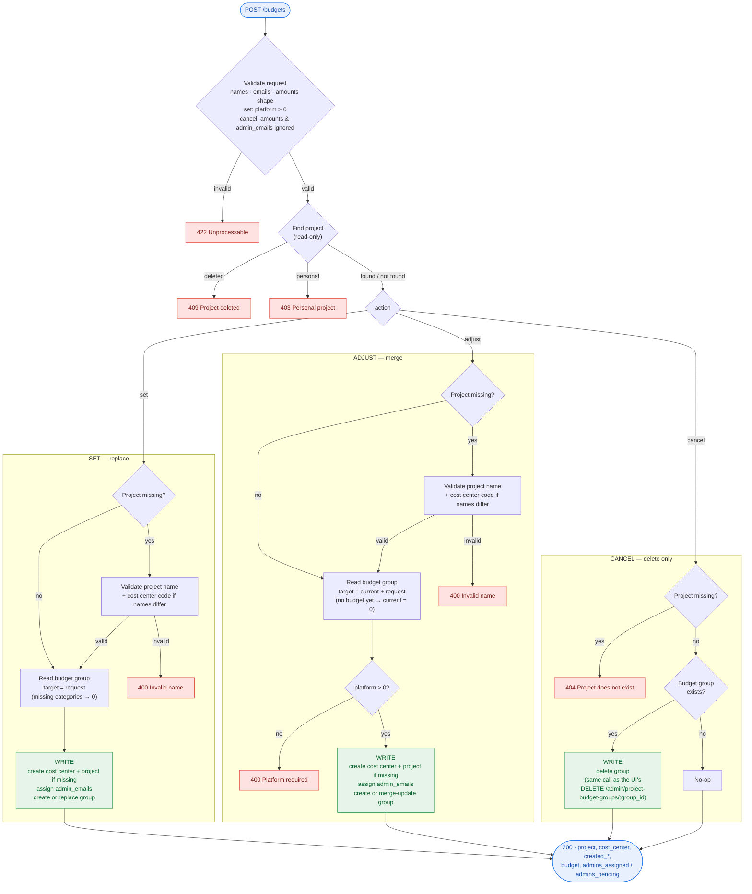

# ServiceNow budget request flow

`POST /v1/integrations/servicenow/budgets`. Every request checks first and writes second: a request that fails a check changes nothing.

## At a glance

| | `set` | `adjust` | `cancel` |
|---|---|---|---|
| Project missing | create it (+ cost center if names differ) | create it (+ cost center if names differ) | 404 |
| Budget missing | create from request | create from request (merge with nothing) | 200, no-op |
| Budget present | replace: categories not sent are removed | merge: categories not sent are kept; `0` removes one | delete it |
| `admin_emails` | assigned | assigned | ignored |
| `amounts` | required, `platform > 0` (else 422) | required; resulting `platform > 0` (else 400) | ignored |
| Budget service call (same as the UI) | `create_project_budget_group` / `update_project_budget_group` | `create_project_budget_group` / `update_project_budget_group` | `delete_project_budget_group` |
| Cost center code validated | only when creating a cost center | only when creating a cost center | never |
| Existing project's cost center | untouched | untouched | untouched |
| Failed check | nothing written | nothing written | nothing written |
